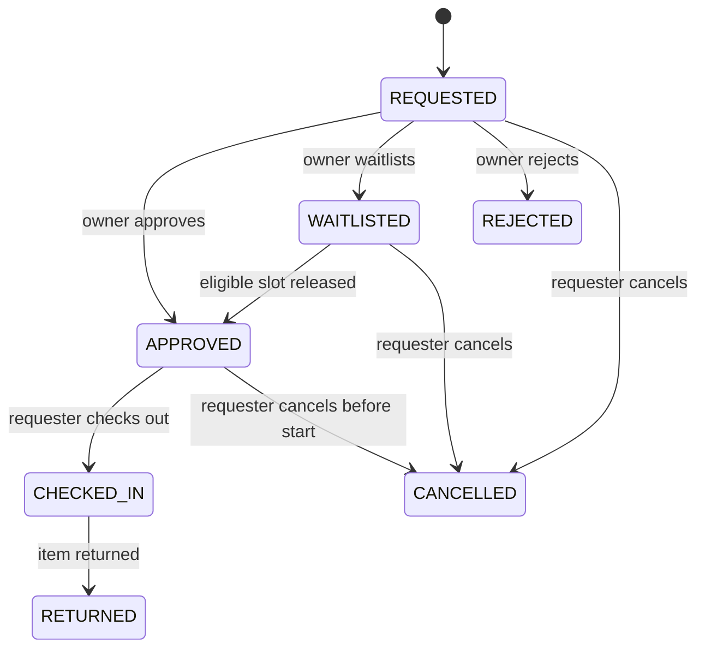

# CampusShare

CampusShare is a campus resource booking platform. Students can discover shared rooms, lab equipment, cameras, and other campus resources, then request a time slot. Resource owners manage their listings and review booking requests.

**GitHub:** [syedsp324/Campus-Share](https://github.com/syedsp324/Campus-Share)

## Features

- Browse and search active campus resources by category.
- Preview active listings before signing in; resource requests still require an account.
- Request bookings with a purpose, reason, and duration. Custom durations can be entered in 15-minute increments, within each resource's limit.
- Sign in with the shared User or Owner demo account. New account registration is disabled.
- View and manage your bookings.
- Let resource owners create and update listings, set maximum booking durations, and approve, waitlist, or decline requests.
- Promote the highest-ranked eligible waitlist request automatically when an upcoming approved booking is cancelled.
- Explain waitlist order with a score based on time waiting, adjusted for the requester's recent use of that resource.
- Record condition reports during check-in and return.
- Enforce authentication, role permissions, booking limits, and availability checks through Supabase and server-side actions.

## Tech stack

- Next.js 16 with React 19 and TypeScript
- Tailwind CSS 4
- Supabase Auth and PostgreSQL
- pgTAP database tests and Playwright browser tests

## Getting started

### Requirements

- Node.js and npm
- A Supabase project

### 1. Clone and install

```bash
git clone https://github.com/syedsp324/Campus-Share.git
cd Campus-Share
npm install
```

### 2. Configure Supabase

In your Supabase project, find the Project URL and publishable key in **Project Settings → API Keys**. Create a `.env.local` file in the project root:

```env
NEXT_PUBLIC_SUPABASE_URL=https://YOUR-PROJECT.supabase.co
NEXT_PUBLIC_SUPABASE_PUBLISHABLE_KEY=YOUR_SUPABASE_PUBLISHABLE_KEY
NEXT_PUBLIC_SITE_URL=http://localhost:3000
```

Replace the example values with your project's values. Keep `.env.local` on your computer; it is ignored by Git. Do not put a Supabase secret or service-role key in a `NEXT_PUBLIC_` variable.

### 3. Set up the database

In the Supabase SQL Editor, run the SQL files in `supabase/migrations` in filename order:

1. `202610280001_initial_schema.sql`
2. `202610280002_booking_workflow.sql`
3. `202610280003_lifecycle.sql`
4. `202610290003_checkin_return.sql`
5. `202610290004_booking_reads.sql`
6. `202610290005_resources_select_grant.sql`
7. `202610300001_public_resource_discovery.sql`
8. `202610300002_waitlist_promotion_priority.sql`

These migrations create the tables, access policies, and booking functions used by the app. If your project already has migrations 1–6, run migrations 7 and 8 in order; do not rerun earlier files.

### 4. Configure Supabase Auth

In **Supabase → Authentication → URL Configuration**, set the Site URL to `https://campus-share-0uy5.onrender.com` and add these Redirect URLs:

```text
https://campus-share-0uy5.onrender.com/auth/callback
https://campus-share-0uy5.onrender.com/auth/confirm
http://localhost:3000/auth/callback
http://localhost:3000/auth/confirm
```

Add your custom domain too if you use one. Keep `NEXT_PUBLIC_SITE_URL=http://localhost:3000` in local `.env.local`; set `NEXT_PUBLIC_SITE_URL=https://campus-share-0uy5.onrender.com` in Render's environment settings. If unset, the app validates and uses the current request origin.

To make sign-in-only access effective for the Supabase project too, disable **Allow new users to sign up** under **Supabase → Authentication → General configuration**. Supabase then allows existing accounts to sign in but rejects new registrations. [Supabase Auth configuration](https://supabase.com/docs/guides/auth/general-configuration)

Keep email confirmation enabled for existing accounts. Configure a custom SMTP provider in **Supabase → Authentication → SMTP Settings** if password-recovery emails need reliable delivery. [Supabase email sending guidance](https://supabase.com/docs/guides/auth/auth-smtp)

Demo accounts are provisioned in advance. Owner and administrator roles are assigned by an authorized administrator.

### 5. Run locally and sign in

Open the app and use the **User** or **Owner** tab on the sign-in page to fill the corresponding shared demo account. New account registration is disabled in CampusShare. Password recovery is available from the sign-in page.

Start the development server:

```bash
npm run dev
```

Open [http://localhost:3000](http://localhost:3000).

## Useful commands

```bash
npm run dev       # Start the development server
npm run lint      # Run ESLint
npx tsc --noEmit  # Check TypeScript types
npm run build     # Create a production build
npm start         # Start the production server after building
npm run test:e2e  # Run the Playwright sign-in journey checks
supabase test db  # Run pgTAP database tests against local Supabase
```

The database test command needs the Supabase CLI, a local Supabase stack, and the project's local CLI config. If `supabase/config.toml` is missing, run `supabase init` once, then `supabase start`. Do not point database tests at the deployed project.

## Architecture and booking states

The browser submits user actions to Next.js server actions. Those actions call PostgreSQL functions in Supabase; the functions validate roles, quotas, allowed state changes, and resource availability, then write booking and audit rows in one transaction. PostgreSQL's exclusion constraint is the final guard against overlapping approved bookings.



Waitlist promotion currently runs inside the cancellation database function, so releasing the slot and promoting the next eligible request commit together. The score is waiting days minus two points for each completed use of the same resource in the past 30 days. Ties go to the earlier request. Purpose is displayed to owners but is not used to rank people. `CLOSED`, `OVERDUE`, `DISPUTED`, `VERIFYING`, and `PENDING_REVIEW` are representable in the database and included in reviewer fixtures, but the app currently has no transitions into those states.

## Reviewer demo data

`supabase/seeds/reviewer_demo_bookings.sql` prepares example bookings for the pre-provisioned demo student and owner, covering requests, review, waitlist, active, completed, rejected, cancelled, overdue, and disputed pages. It is an optional data script, not a migration. It replaces only its own fixed fixture IDs and requires an active resource owned by the demo owner. Review the SQL and run it manually in the intended demo Supabase project's SQL Editor after migrations 1–8. It does not create demo accounts or alter other bookings. To remove the fixtures, delete those fixed-ID rows from `audit_events`, `condition_reports`, and `bookings` in that order.

## Tests and current results

- Database tests in `supabase/tests/database/booking_workflow_test.sql` cover overlapping approvals, active-booking quota enforcement, invalid return transitions, and transactional waitlist promotion/score ordering.
- Playwright checks in `tests/e2e/sign-in.spec.ts` cover the User and Owner demo sign-in tabs and confirm sign-up routes back to sign-in.
- Latest local checks: `npx tsc --noEmit` passed and `npm run lint` passed.
- Playwright tests are added but not verified in this environment: the browser runner could not access the local server socket. Run `npm run test:e2e` on a machine where Playwright can reach the local app; the sign-in checks use the configured demo accounts and do not create bookings.
- The pgTAP tests are added but not yet run: the Supabase CLI/local database stack is unavailable in this environment. Start a local Supabase stack, then run `supabase test db`; do not run the test suite against the deployed database.
- Reviewer fixtures are separate from tests and are inserted only when the optional seed SQL is manually run.

## Project structure

```text
app/                 Pages, layouts, and form actions
app/actions/         Server-side Supabase operations
components/          Booking, resource, and account UI
lib/supabase/        Supabase browser and server clients
src/types/           Shared TypeScript types
supabase/migrations/ Database schema, policies, and functions
supabase/tests/     pgTAP database tests
supabase/seeds/     Optional reviewer demo data
tests/e2e/          Playwright browser tests
public/              Static images and other public assets
```

## Roles

- **User:** Browse resources, request bookings, and manage their own bookings.
- **Owner:** Manage owned resources and review their booking requests.
- **Manager/Admin:** Elevated resource and booking-management access as defined by the database policies.

Role checks in the interface are for navigation and usability; the server actions and database policies enforce access.

## Notes

- Booking times are entered in India Standard Time (IST).
- Booking duration, weekly usage, active booking, and availability limits are checked when a request is submitted.
- Demo credentials are shared evaluation accounts, provisioned for this project only; never use real user passwords or production credentials in the repository.
